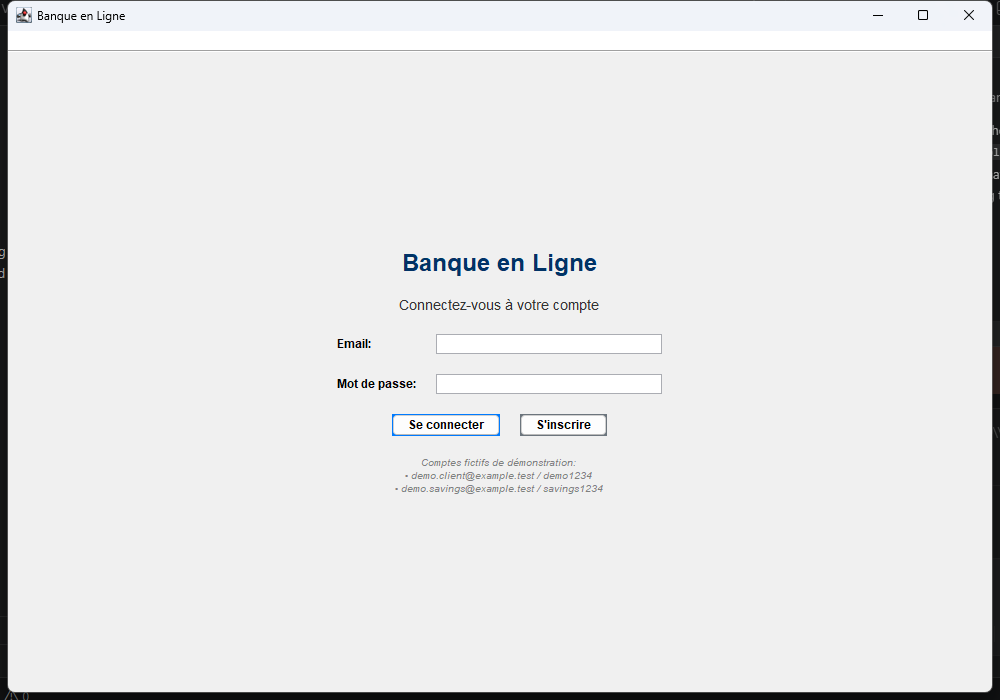
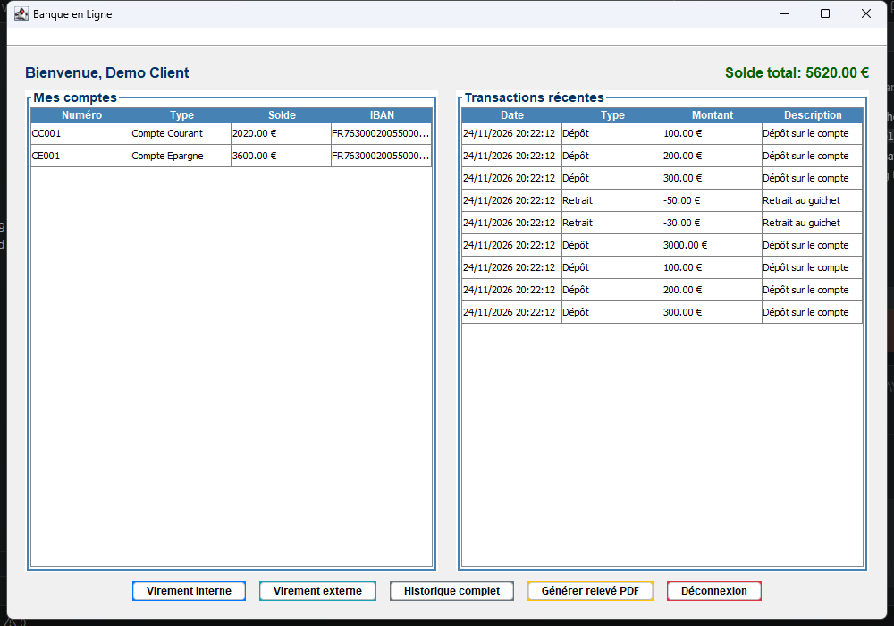
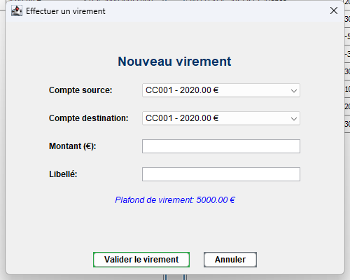
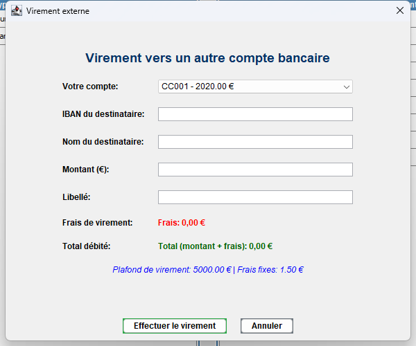
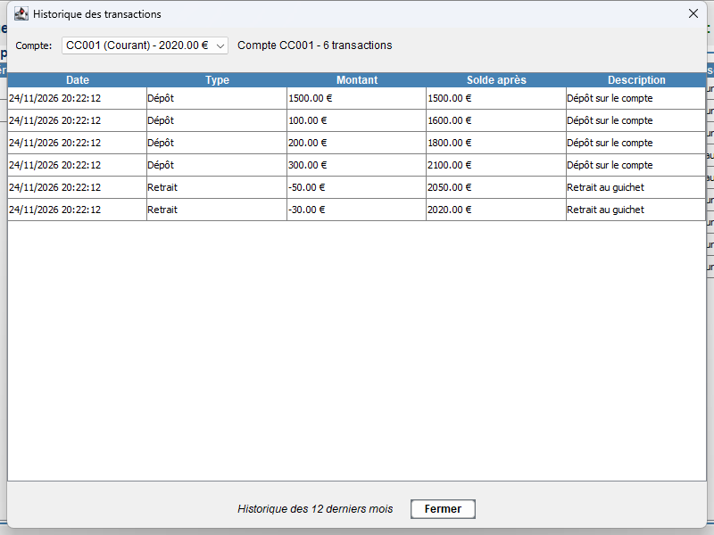

# Banque-En-Ligne

[English](README.md) · [Français](README.fr.md)

Banque-En-Ligne est une démonstration bancaire desktop en Java Swing, structurée avec une approche orientée objet inspirée de MVC. Elle propose l'authentification de clients fictifs, des comptes courants et d'épargne, des virements internes et externes, un historique sur 12 mois et l'export de relevés au format texte.

> Cette application est pédagogique. Toutes les identités, informations de connexion, soldes, IBAN et transactions fournis sont fictifs et ne doivent pas être utilisés pour des opérations bancaires réelles.

## Fonctionnalités

- Connexion et inscription avec deux utilisateurs fictifs de démonstration
- Vue d'ensemble des comptes courants et d'épargne, soldes et IBAN générés
- Virements internes entre les comptes d'un client
- Virements externes avec validation, plafond et frais fixes
- Transactions récentes et historique triable des 12 derniers mois
- Export de relevés bancaires mensuels et annuels au format texte
- Interface desktop entièrement réalisée avec Java Swing

## Captures d'écran

### Connexion



### Tableau de bord et gestion des comptes



### Virements

| Virement interne | Virement externe |
| --- | --- |
|  |  |

### Historique des transactions



## Technologies

- Java 17 ou version ultérieure (testé avec Temurin JDK 21)
- Java Swing et AWT
- Collections Java, modèles sérialisables et `java.time`
- Scripts PowerShell pour la compilation, l'exécution et les tests

Aucune bibliothèque tierce ni outil de build n'est nécessaire à l'exécution.

## Prérequis

- Windows 10/11 avec PowerShell 5.1 ou version ultérieure
- JDK 17+ avec `JAVA_HOME` configuré, Java disponible dans le `PATH`, ou un JDK installé dans `%USERPROFILE%\.jdks`
- Git pour cloner le dépôt

## Installation

```powershell
git clone https://github.com/yasser-dev-code/Banque-En-Ligne.git
cd Banque-En-Ligne
```

Compiler l'application :

```powershell
.\scripts\build.ps1
```

## Configuration de la base de données

La version actuelle n'utilise **ni MySQL ni aucune autre base de données externe**. Les données fictives de démonstration sont initialisées en mémoire par `AuthControleur` et `CompteControleur`, puis réinitialisées à chaque démarrage. Par conséquent :

- aucun serveur de base de données n'est requis ;
- aucun schéma ni migration ne doit être appliqué ;
- aucun identifiant de base de données ni fichier `.env` n'est nécessaire ;
- les données ne persistent pas entre les sessions.

Cette configuration correspond au code source actuel et conserve l'autonomie de la démonstration pédagogique. Une future couche de persistance devra charger ses secrets depuis des variables d'environnement ou un fichier local ignoré par Git, jamais depuis le code versionné.

## Lancer l'application

```powershell
.\scripts\run.ps1
```

Les comptes fictifs sont affichés sur l'écran de connexion. Par exemple :

- `demo.client@example.test` / `demo1234`
- `demo.savings@example.test` / `savings1234`

## Tests

Lancer le test de fumée sans dépendance externe :

```powershell
.\scripts\test.ps1
```

Il vérifie le refus et l'acceptation de l'authentification, le chargement des comptes, les virements internes et externes, les frais, l'historique et la déconnexion.

## Structure du projet

```text
Banque-En-Ligne/
├── BanqueEnLigne/
│   └── src/banque/
│       ├── controleurs/       # Authentification, comptes et virements
│       ├── modele/            # Clients, comptes, transactions, exceptions
│       ├── services/          # Historique, intérêts et relevés
│       ├── vue/               # Fenêtres Swing et composants réutilisables
│       └── Main.java          # Point d'entrée de l'application
├── docs/screenshots/          # Captures réelles de l'application lancée
├── scripts/                   # Scripts de build, lancement et test
├── tests/banque/              # Test de fumée sans dépendance
├── README.md
└── README.fr.md
```

## Notes de sécurité

- Les mots de passe et données bancaires inclus sont uniquement des valeurs fictives de démonstration.
- `.gitignore` exclut les fichiers d'environnement locaux, les keystores, les sorties compilées, les journaux et les relevés générés.
- L'authentification en mémoire actuelle est pédagogique ; un système de production nécessiterait le hachage des mots de passe, une persistance sécurisée, des journaux d'audit et une revue de sécurité complète.

## Licence

Voir [LICENSE](LICENSE).
