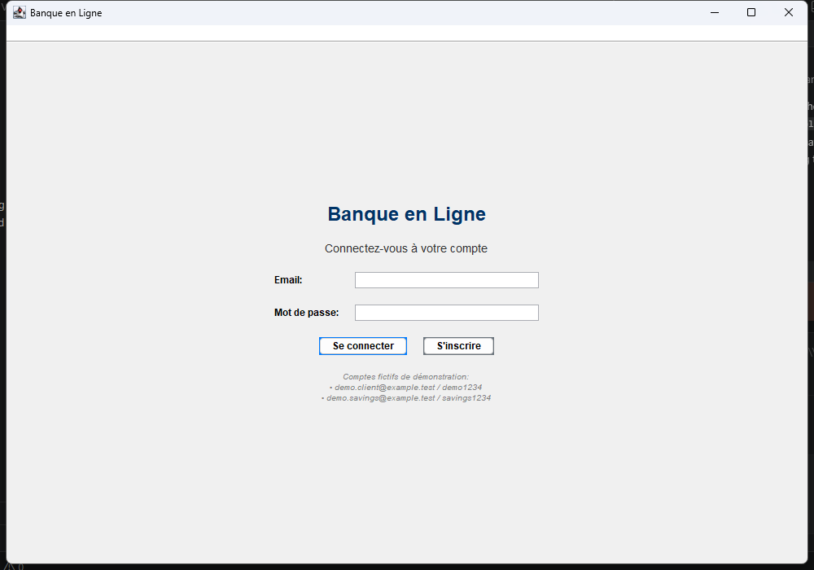
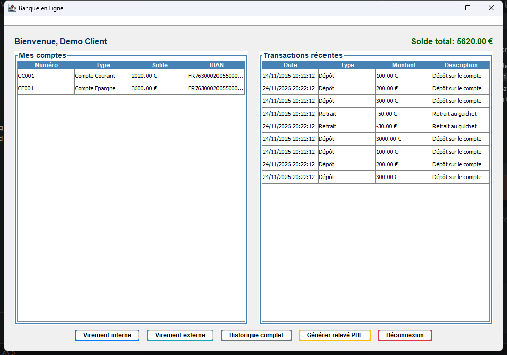
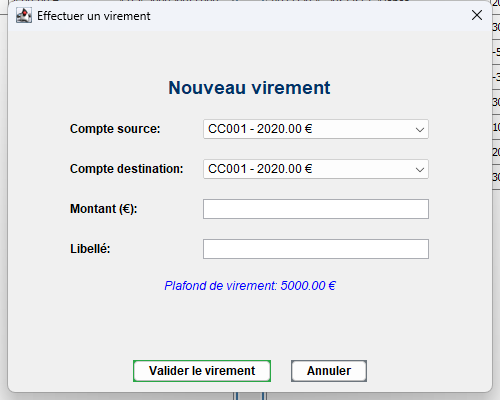
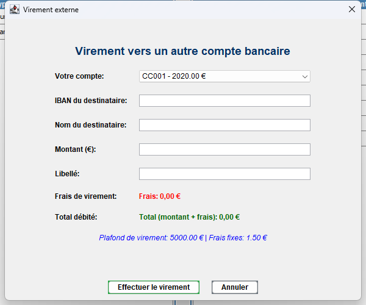
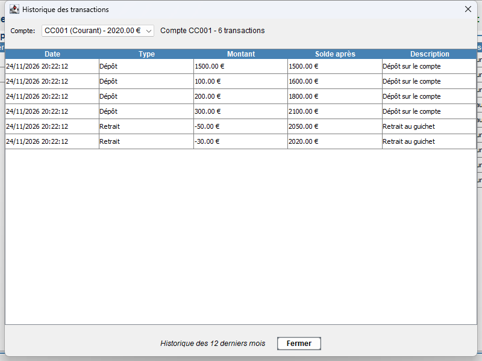

# Banque-En-Ligne

[English](README.md) · [Français](README.fr.md)

Banque-En-Ligne is a Java Swing desktop banking demonstration built with object-oriented and MVC-inspired design. It provides fictional client authentication, checking and savings accounts, internal and external transfers, a 12-month transaction history, and text statement exports.

> This is an educational application. All bundled identities, credentials, balances, IBANs, and transactions are fictional and must not be used for real banking.

## Features

- Login and registration flows with two fictional demonstration users
- Checking and savings account overview with balances and generated IBANs
- Internal transfers between a client's accounts
- External transfers with validation, a transfer limit, and a fixed fee
- Recent transactions and sortable 12-month transaction history
- Monthly and annual bank statement export in plain-text format
- Desktop interface implemented entirely with Java Swing

## Screenshots

### Login



### Dashboard and account management



### Transfers

| Internal transfer | External transfer |
| --- | --- |
|  |  |

### Transaction history



## Technologies

- Java 17 or later (tested with Temurin JDK 21)
- Java Swing and AWT
- Java collections, serialization-ready models, and `java.time`
- PowerShell helper scripts for build, run, and smoke tests

No third-party runtime libraries or build tool are required.

## Prerequisites

- Windows 10/11 with PowerShell 5.1 or later
- JDK 17+ with `JAVA_HOME` configured, Java available on `PATH`, or a JDK installed under `%USERPROFILE%\.jdks`
- Git, if cloning the repository

## Installation

```powershell
git clone https://github.com/yasser-dev-code/Banque-En-Ligne.git
cd Banque-En-Ligne
```

Build the application:

```powershell
.\scripts\build.ps1
```

## Database configuration

The current version does **not** use MySQL or another external database. Its fictional demonstration data is initialized in memory by `AuthControleur` and `CompteControleur`, then reset each time the application starts. Consequently:

- no database server is required;
- no schema or migration must be applied;
- no database credentials or `.env` file are needed;
- data is not persisted between sessions.

This matches the current source code and keeps the educational demo self-contained. A future persistence layer should load credentials from environment variables or an ignored local configuration file, never from committed source code.

## Running the application

```powershell
.\scripts\run.ps1
```

Fictional demonstration accounts are shown on the login screen. For example:

- `demo.client@example.test` / `demo1234`
- `demo.savings@example.test` / `savings1234`

## Tests

Run the dependency-free smoke test:

```powershell
.\scripts\test.ps1
```

It verifies authentication rejection and acceptance, account loading, internal and external transfers, fees, transaction history, and logout.

## Project structure

```text
Banque-En-Ligne/
├── BanqueEnLigne/
│   └── src/banque/
│       ├── controleurs/       # Authentication, accounts, and transfers
│       ├── modele/            # Clients, accounts, transactions, exceptions
│       ├── services/          # History, interest, and statement exports
│       ├── vue/               # Swing windows and reusable components
│       └── Main.java          # Application entry point
├── docs/screenshots/          # Real screenshots from the running app
├── scripts/                   # Build, run, and test helpers
├── tests/banque/              # Dependency-free smoke test
├── README.md
└── README.fr.md
```

## Security notes

- Bundled passwords and account data are fictional demonstration values.
- `.gitignore` excludes local environment files, keystores, compiled output, logs, and generated statements.
- The current in-memory authentication is intended for learning only; a production system would require password hashing, persistent storage, audit controls, and a full security review.

## License

See [LICENSE](LICENSE).
